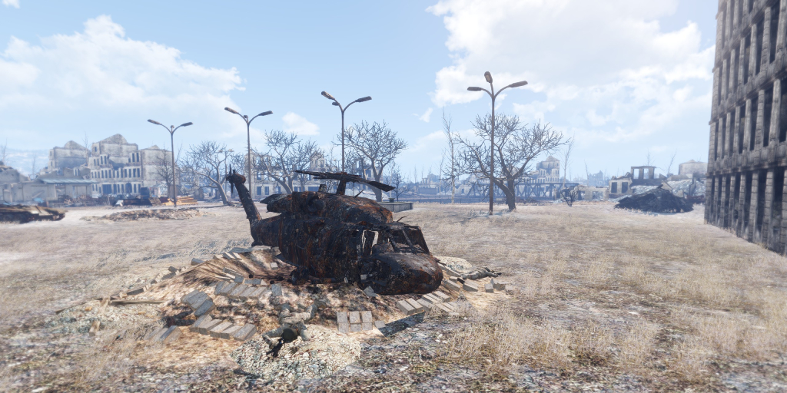

# Pecher massacre [COOP 2-4] for Arma 3

This is a 2-4 players coop scenario for Arma 3.

[Steam Workshop page](https://steamcommunity.com/sharedfiles/filedetails/?id=3818649097).

## Plot

Alpha 1-1 is sent to Pecher to locate and rescue the missing Alpha 1-2 crew
after reports of a massive unidentified biological threat.
With no further contact and time running out, your squad must investigate the crash site,
eliminate the hostile creature, and exfiltrate.
Russian ammunition and an abandoned tactical nuclear launch vehicle may provide the firepower
needed to bring the threat down.

## Features & advices

This mission features a high degree of randomness and is designed for high replayability.
No two playthroughs are guaranteed to be the same, so take your time and think carefully before acting.

Things may not always go according to plan, but failure doesn't necessarily mean the situation is hopeless.
Adapt, improvise, and look for alternative ways to achieve your objectives.
The mission can be brutal and unforgiving, and death is permanent.

Stay alive, stay alert, and use your head.
Caution, cunning, and quick reflexes will be your greatest assets.
Good luck out there. You'll need it.

## Limitations & recommendations

### ACE

You need at least one team member familiar with ACE controls to be able to:

- heal wounds;
- fuel vehicles;
- clear jams.

And you might also want to:

- repack magazines;
- use flashlights on map;
- load cargo;
- replace tires;
- tow vehicles;
- etc.

### Game object virtualization

For optimization purposes, most units and vehicles in this scenario are tracked virtually
and only rendered when they are within a certain distance. While this helps improve performance,
it also comes with a few drawbacks:

- Nuclear strikes will usually kill only the main boss, as it is always rendered regardless of distance.
- You may occasionally notice weaker zombies spawning 100–200 meters away as they become visible.
- FPS may drop in Pecher as large numbers of zombies become visible simultaneously. Unfortunately, the Arma 3 engine struggles to handle large crowds.

### Dedicated server

Run this scenario on a dedicated server if possible. Doing this may significantly improve FPS for the host
and clients.

This repo has [start-server.ps1](start-server.ps1), which is a PowerShell script that starts the server.
Use it as an example, but you will need to adjust the parameters. And also add `pecher_massacre.carter_winter.pbo`
to the `.../Arma 3/MPMissions` directory.

### Headless clients are not supported

This scenario does not allow headless clients.

## Required mods

- [ace](https://steamcommunity.com/sharedfiles/filedetails/?id=463939057)
- [CBA_A3](https://steamcommunity.com/sharedfiles/filedetails/?id=450814997)
- [CUP Terrains - Core](https://steamcommunity.com/sharedfiles/filedetails/?id=583496184)
- [CUP Terrains - CWA](https://steamcommunity.com/sharedfiles/filedetails/?id=853743366)
- [CUP Terrains - Maps](https://steamcommunity.com/sharedfiles/filedetails/?id=583544987)
- [Improved Melee System](https://steamcommunity.com/sharedfiles/filedetails/?id=2291129343)
- [Pecher](https://steamcommunity.com/sharedfiles/filedetails/?id=708597484)
- [RHSAFRF](https://steamcommunity.com/sharedfiles/filedetails/?id=843425103)
- [RHSUSAF](https://steamcommunity.com/sharedfiles/filedetails/?id=843577117)
- [WebKnight's Zombies and Creatures](https://steamcommunity.com/sharedfiles/filedetails/?id=2789152015)
